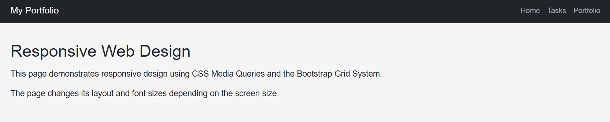
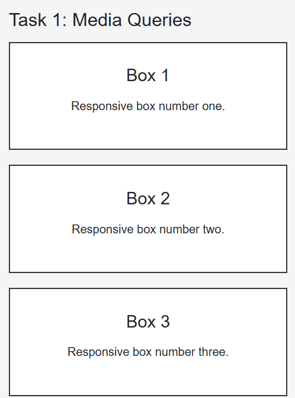
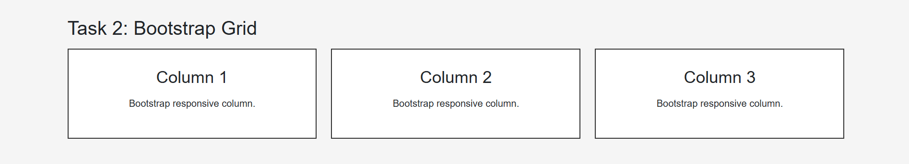
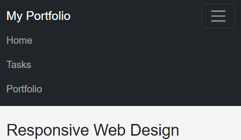
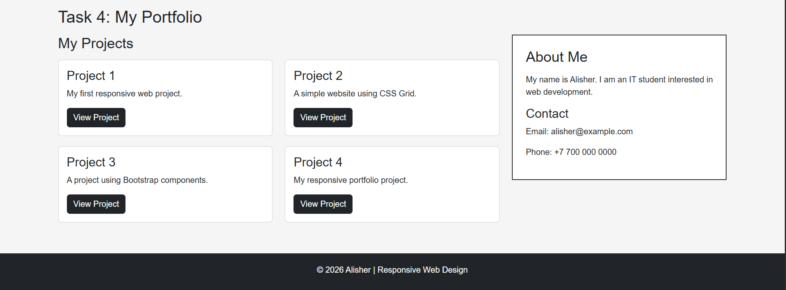
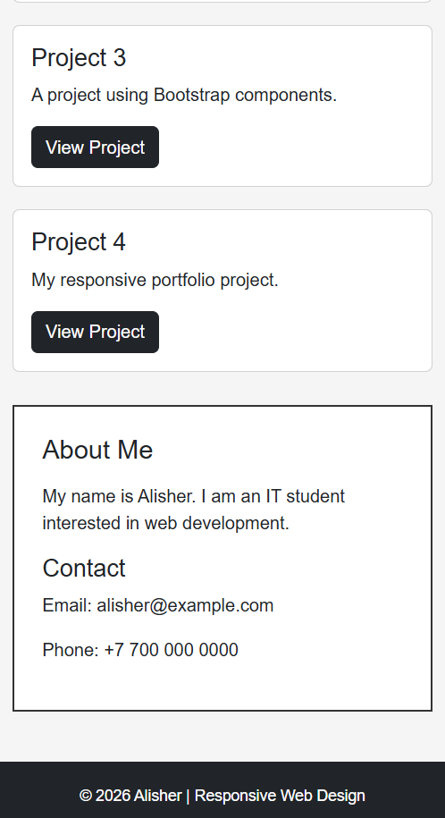

# Assignment #3 - Responsive Web Design

Name: Alisher Yeskermes  
Group: IT-2501

## About the assignment

In this assignment I worked with responsive web design.

I used CSS Media Queries and Bootstrap Grid to make the website work on desktop, tablet and mobile screens.

---

# Task 0 - Responsive Typography

For this task I created a simple section with a heading and paragraphs.

I used Media Queries to change the font size depending on the screen size.

---

# Task 1 - Responsive Layout

I created three boxes in one row.

On smaller screens the boxes change their position using CSS Media Queries.

On desktop there are three boxes in one row, and on mobile they are displayed one under another.

---

# Task 2 - Bootstrap Grid

For this task I used the Bootstrap 12-column grid.

The columns have different sizes depending on the screen:

- Desktop: 4 columns for each element
- Tablet: 6 columns for each element
- Mobile: 12 columns for each element

---

# Task 3 - Bootstrap Navbar

I created a responsive navigation bar using Bootstrap.

It has a logo and navigation links. On a smaller screen the links are hidden inside a hamburger menu.

---

# Task 4 - Responsive Portfolio

For the final task I created a simple portfolio page.

It contains:

- Navigation bar
- My projects
- About Me section
- Contact information
- Footer

I used Bootstrap Grid for the main layout and Media Queries for additional responsive changes.

### Desktop

### Mobile

---

# Work process

First, I created the HTML structure of the website.

Then I added CSS for the main design and Media Queries for different screen sizes.

After that I added Bootstrap and used its grid system and navbar.

Finally, I tested the website on desktop and mobile screen sizes.

---

# Technologies

- HTML
- CSS
- Media Queries
- Bootstrap 5
- VS Code
- GitHub

---

# Conclusion

This assignment helped me understand how responsive websites work.

I learned how to use Media Queries and Bootstrap Grid to make a website look better on different screen sizes.